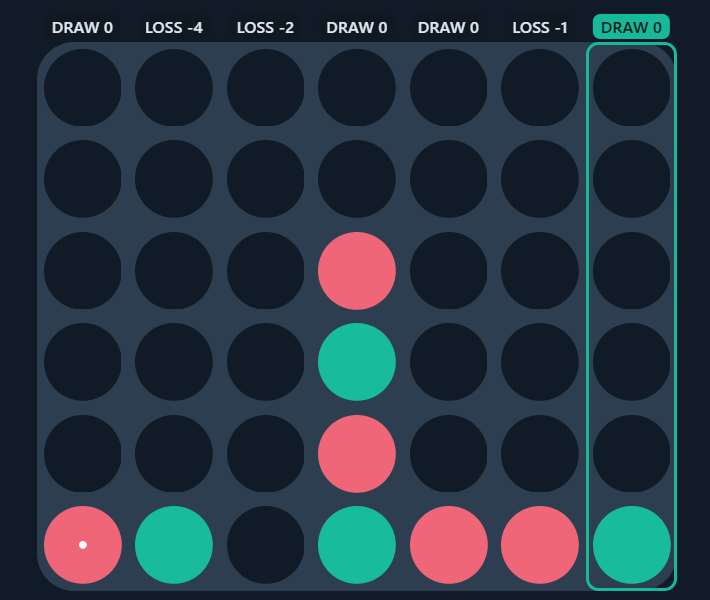
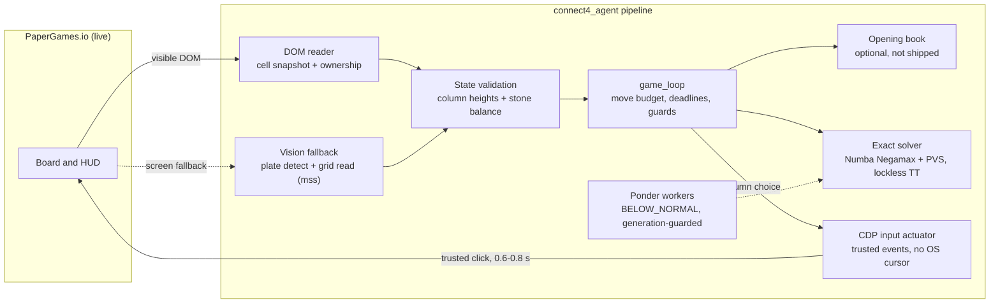

# connect4_agent

[](https://www.python.org/downloads/)
[](LICENSE)
[](#key-metrics)
[](#quick-start-offline)

[Русская версия](README.ru.md)

**An exact-play Connect 4 engine with a multi-threaded search core and a live vision/CDP benchmark harness.**

## What this is

This project is systems engineering in three layers:

1. **Perfect-play engine** — a bitboard Negamax solver following the published algorithm of
   Pascal Pons: binary-search score resolution, a lockless transposition table shared by search
   threads, principal-variation search and a move-ordering heuristic.
   Validated against the reference benchmark: **6/6 position sets solved 100%**, ≈8.1M nodes/s
   average (27.4M peak) on a 4-core laptop CPU.
2. **State readers** — two independent board-state pipelines: a DOM reader and a pure
   **computer-vision fallback** (screen capture, board-plate detection, multi-sample cell
   classification), cross-checked cell-by-cell: **42/42 cells**, verified at two display scales.
3. **Live benchmark harness** — CDP-driven input (trusted input events, **no OS cursor movement**,
   0.6–0.8 s click round-trip) with a physical-mouse fallback, plus an evaluation overlay rendered
   directly over the board.

The live harness is used as a *real-environment test bench*: it exercises the engine and the CV
pipeline under real rendering, animations, network latency and a real interface.

## Demo



Per-column exact scores (`WIN`/`LOSS`/`DRAW` with distance) rendered as an overlay during a live game.

## Key metrics

| Metric | Value |
|---|---|
| Benchmark gate (reference datasets) | **6/6 sets, 100%** of positions solved correctly |
| Search speed | ≈8.1M nodes/s average, 27.4M peak (i5-11300H, 4C/8T, Numba `nogil`) |
| Transposition table | 16 B/entry, lockless; packed entry + `key ^ entry` verification |
| Live click round-trip (CDP) | **0.6–0.8 s** (single flight + atomic click; was 17–22 s before optimization) |
| Vision fallback | **42/42 cells** vs DOM, at 125% and 100% display scale |
| Live series vs the site's strongest bot | 20 games: **11 W / 7 L / 2 D**; **3/3 as first player** |

## Before / after (measured on the live bench)

| Stage | First working version | Hardened version | Measured effect |
|---|---|---|---|
| Click delivery | stepwise cursor animation, ~30 CDP round-trips | one mouse flight + one atomic `click(delay)` | **17–22 s → 0.6–0.8 s** per click under CPU load |
| Move ordering | one scratch buffer shared by all search threads | per-thread scratch + invalid-move guard | phantom children gone; exact scores restored (replay-proven) |
| Click verification | global stone counter (racy vs a simultaneous opponent move) | count of *our* stones + turn hand-off | no false retries, no duplicate placements |
| Site timing traps | strict ±0 ownership invariant | tolerance `abs(balance) ≤ 1` + 6 s phantom-move watchdog | dead forfeits eliminated (was 150+ false triggers per game) |
| Board vision | single color threshold on the plate | 35%-of-max profile threshold + aspect repair | **42/42 cells** at 100% and 125% display scale |

## Architecture



Repository layout:

```
connect4_agent/
  engine/       bitboard, Numba solver, lockless TT, opening-book loader, ponder manager
  browser/      CDP connector, DOM reader, vision fallback, overlay, CDP input
  actuator/     physical mouse controller, global hotkeys
  state/        session tracker, game loop, incident dumps, bot PID lock
  tools/        live probes, robot-game driver, series runner
  tests/        offline suites (mocked page, no browser needed) + benchmark runners
  docs/         engineering log, demo asset
```

## Engineering highlights

Four cases from the live bench — full write-ups in
[docs/ENGINEERING_LOG.md](connect4_agent/docs/ENGINEERING_LOG.md):

- **The buffer race that moved pieces on its own.** Ponder workers and the main search shared the
  same move-ordering scratch rows; at equal depth a foreign move (up to a full column) leaked into
  a node and produced phantom children with corrupted scores. Caught by replaying a lost game with
  the reference book as an oracle (the engine played column 2 into a draw while column 6 wins at
  +1). Fixed with per-thread scratch, an invalid-move guard (`engine.invalid_moves` is 0 in a
  healthy run) and generation-tagged workers.
- **A lockless table you can prove safe.** One packed 64-bit word per entry (score, bound, move,
  depth) plus `check = key ^ entry`; the verification `check ^ d == key` stays exact even under
  torn reads, because the packed payload is far smaller than the table's bucket stride. All search
  threads share the table without locks.
- **The 22-second click.** Driving the cursor in many small CDP steps collapsed under CPU load:
  17–22 s per click and timeouts. One mouse flight + one atomic `click(delay)` — plus
  `BELOW_NORMAL` priority for ponder threads, so they yield CPU to the input path — brought it to
  a measured **0.6–0.8 s** per click, with the OS cursor never moving.
- **Reading a hostile board.** Invisible nickname clones, per-side disc colors, CSS-class
  ownership, hover placeholders, ad-driven layout shifts and a ~1 s marker lag each broke a naive
  reader in live play. The reader now works on visible geometry and classes, and the ownership
  check tolerates `abs(balance) ≤ 1` with a phantom-move watchdog.

## Quick start (offline)

```bash
py -3 -m venv .venv
.venv\Scripts\python -m pip install -r connect4_agent/requirements.txt
.venv\Scripts\python connect4_agent/run.py --selftest        # engine warm-up + sanity values
.venv\Scripts\python connect4_agent/tests/test_stage5_offline.py   # and the other *_offline suites
```

All `*_offline` suites are self-contained (mocked page, no browser, no network).

### Configuration

Every setting is an optional environment variable — the project reads the process environment
directly, nothing is auto-loaded. [`.env.example`](.env.example) documents the full set:

| Variable | Default | Purpose |
|---|---|---|
| `C4_PLAYER_NAME` | `Player` | nickname of our account; the reader uses it to pick the side |
| `C4_FRIEND_NAME` | `PlayerFriend` | nickname used by `tools/opponent_bot.py` for robot matches |
| `C4_INCIDENTS_DIR` | `logs/incidents` | where incident dumps are written |
| `C4_TOAST` | bundled toast script | helper invoked between series runs by `tools/acceptance_series.py` |

## Live harness (optional)

```bash
msedge.exe --remote-debugging-port=9222        # or any Chromium-based browser
.venv\Scripts\python connect4_agent/run.py --live
# hotkeys: F7 auto/hint · F8 pause · F9 resync · double-Esc exit
```

Input mode is `cdp` by default (the OS cursor is never touched and the window does not need
focus); `INPUT_MODE = "physical"` in `config.py` switches to the pyautogui fallback.

## Opening book (not shipped)

The engine reaches full strength with an optional opening book (16.5M positions, compact `.npz`,
≈40 MB). It is **intentionally not included**: the reference book data is published by Pascal Pons
under **AGPL-3.0** and is not redistributable inside this MIT-licensed project. The loader
(`engine/opening_book.py`) documents the file format; the engine also plays standalone without it
(the decision cascade falls back to the exact solver).

## Acknowledgments & disclaimer

- The engine follows the **published algorithm and benchmarks of Pascal Pons** (bitboard
  representation, negamax with binary-search score resolution, lockless transposition table).
  His code and opening-book data are AGPL-3.0 and are **not** included in this repository.
- This project is for **research and benchmarking purposes**. Automating third-party services may
  violate their terms of use; use it only where you are authorized (for example, on your own
  account) and at your own risk.

## License

[MIT](LICENSE)
