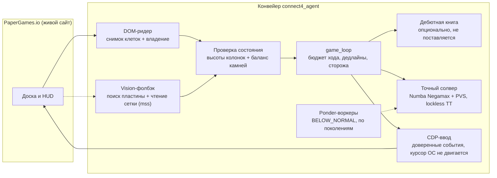

# connect4_agent

[](https://www.python.org/downloads/)
[](LICENSE)
[](#ключевые-метрики)
[](#быстрый-старт-офлайн)

[English version](README.md)

**Движок «Четыре в ряд» с точной игрой, многопоточным ядром поиска и живым стендом компьютерного зрения и ввода через CDP.**

## Что это

Проект состоит из трёх слоёв:

1. **Движок точной игры** — Negamax на битбордах по опубликованному алгоритму Паскаля Понса:
   бисекция при определении оценки, lockless-таблица транспозиций, общая для потоков поиска,
   principal-variation search и эвристика сортировки ходов.
   Проверен на эталонных наборах: **6/6 наборов, 100% позиций решены верно**, в среднем ≈8.1 млн узлов/с
   (пик 27.4 млн) на 4-ядерном ноутбуке.
2. **Читатели состояния** — два независимых контура: чтение через DOM и **чистый computer-vision
   фолбэк** (захват экрана, поиск пластины доски, многократный семплинг клеток), сверенные по клеткам:
   **42/42**, на двух масштабах экрана.
3. **Живой стенд** — ввод через CDP (доверенные события, **курсор ОС не двигается**, отклик клика
   0.6–0.8 с) с фолбэком на физическую мышь, и оверлей с оценками прямо над доской.

Живой стенд используется как *тестовый полигон*: он гоняет движок и CV-контур в реальных условиях —
рендеринг, анимации, сетевая задержка, живой интерфейс.

## Демо


Точные оценки колонок (`WIN`/`LOSS`/`DRAW` с дистанцией), отрисованные оверлеем в живой партии.

## Ключевые метрики

| Метрика | Значение |
|---|---|
| Гейт на эталонных наборах | **6/6 наборов, 100%** позиций решены верно |
| Скорость поиска | ≈8.1 млн узлов/с в среднем, 27.4 млн пик (i5-11300H, 4C/8T, Numba `nogil`) |
| Таблица транспозиций | 16 Б/запись, lockless; упакованная запись + проверка `key ^ entry` |
| Отклик клика (CDP) | **0.6–0.8 с** (один перелёт + атомарный клик; до оптимизации 17–22 с) |
| Vision-фолбэк | **42/42 клетки** против DOM, при масштабах 125% и 100% |
| Живая серия против сильнейшего бота сайта | 20 партий: **11 П / 7 Пр / 2 Н**; **3/3 за первого игрока** |

## Было → стало (замеры на живом стенде)

| Этап | Первая рабочая версия | Закалённая версия | Замеренный эффект |
|---|---|---|---|
| Доставка клика | пошаговая анимация курсора, ~30 CDP-вызовов | один перелёт + один атомарный `click(delay)` | **17–22 с → 0.6–0.8 с** на клик под нагрузкой |
| Сортировка ходов | общий буфер сортировки на все потоки поиска | буферы на поток + защита от невалидных ходов | фантомные дети исчезли, точные оценки восстановлены (доказано переигровкой) |
| Проверка клика | общий счётчик камней (гонка с одновременным ходом соперника) | счётчик НАШИХ камней + передача хода | нет ложных повторов и дублирующих постановок |
| Тайминги сайта | жёсткий инвариант владения ±0 | допуск `abs(balance) ≤ 1` + сторож фантомного хода 6 с | мёртвые форфейты устранены (было 150+ ложных срабатываний за игру) |
| Зрение | один цветовой порог по пластине доски | профиль 35% от максимума + aspect-repair | **42/42 клетки** при масштабах 100% и 125% |

## Архитектура



Структура репозитория:

```
connect4_agent/
  engine/       битборды, Numba-солвер, lockless-ТТ, загрузчик книги, менеджер pondering
  browser/      CDP-коннектор, DOM-ридер, vision-фолбэк, оверлей, CDP-ввод
  actuator/     физическая мышь, глобальные хоткеи
  state/        сессия, игровой цикл, дампы инцидентов, PID-локфайл бота
  tools/        живые зонды, драйвер робо-игр, раннер серий
  tests/        офлайн-наборы (мок страницы, браузер не нужен) + бенчмарк-раннеры
  docs/         инженерный постмортем, демо-ассет
```

## Инженерные находки

Четыре кейса с живого стенда — полные разборы в
[docs/ENGINEERING_LOG.md](connect4_agent/docs/ENGINEERING_LOG.md):

- **Гонка буферов, которая сама двигала фишки.** Ponder-воркеры и основной поиск делили одни и
  те же строки буфера сортировки ходов; на одной глубине чужой ход (вплоть до полной колонки)
  попадал в узел и порождал «фантомных детей» с испорченными оценками. Поймано переигровкой
  проигранной партии с книгой Понса как оракулом (движок сыграл колонку 2 в ничью, тогда как
  колонка 6 выигрывает с +1). Исправлено буферами на поток, защитой от невалидных ходов
  (`engine.invalid_moves` в здоровом прогоне — 0) и воркерами по поколениям.
- **Lockless ТТ, безопасность которой можно доказать.** Слот — одна упакованная 64-битная запись
  (оценка, граница, ход, глубина) плюс слово проверки `check = key ^ entry`; проверка
  `check ^ d == key` остаётся точной даже при «порванном» гонкой чтении, потому что упакованная
  полезная нагрузка намного меньше шага корзины таблицы. Все потоки делят таблицу без блокировок.
- **Клик на 22 секунды.** Пошаговое ведение курсора множеством мелких CDP-вызовов разваливалось
  под нагрузкой CPU: 17–22 с на клик и тайм-ауты. Один перелёт + один атомарный `click(delay)` —
  и приоритет `BELOW_NORMAL` для ponder-потоков, уступающих CPU контуру ввода, — дали замеренные
  **0.6–0.8 с** на клик, при этом курсор ОС не двигается вовсе.
- **Чтение враждебной доски.** Невидимые дубли ников, цвета фишек по сторонам, владение по
  CSS-классу, клетка hover-превью, сдвиги вёрстки рекламой и задержка маркера ~1 с — каждый из
  этих сюрпризов ломал наивный ридер в живой игре. Сейчас ридер работает на видимой геометрии и
  классах, а проверка владения допускает `abs(balance) ≤ 1` со сторожем фантомного хода.

## Быстрый старт (офлайн)

```bash
py -3 -m venv .venv
.venv\Scripts\python -m pip install -r connect4_agent/requirements.txt
.venv\Scripts\python connect4_agent/run.py --selftest        # прогрев ядра + контрольные значения
.venv\Scripts\python connect4_agent/tests/test_stage5_offline.py   # и остальные *_offline наборы
```

Все наборы `*_offline` самодостаточны (мок страницы, без браузера и сети).

### Конфигурация

Все настройки — опциональные переменные окружения: проект читает окружение процесса напрямую,
ничего не подгружается автоматически. Полный список — в [`.env.example`](.env.example):

| Переменная | По умолчанию | Назначение |
|---|---|---|
| `C4_PLAYER_NAME` | `Player` | ник нашего аккаунта; по нему ридер определяет сторону |
| `C4_FRIEND_NAME` | `PlayerFriend` | ник для `tools/opponent_bot.py` (робо-матчи) |
| `C4_INCIDENTS_DIR` | `logs/incidents` | куда складываются дампы инцидентов |
| `C4_TOAST` | встроенный скрипт тоста | хелпер между прогонами серий в `tools/acceptance_series.py` |

## Живой стенд (опционально)

```bash
msedge.exe --remote-debugging-port=9222        # или любой Chromium-браузер
.venv\Scripts\python connect4_agent/run.py --live
# хоткеи: F7 auto/hint · F8 пауза · F9 ресинк · двойной Esc — выход
```

Режим ввода по умолчанию — `cdp` (курсор ОС не двигается, фокус окна не нужен);
`INPUT_MODE = "physical"` в `config.py` переключает на физическую мышь.

## Дебютная книга (не поставляется)

Движок набирает полную силу с опциональной дебютной книгой (16.5 млн позиций, компактный `.npz`,
≈40 МБ). Она **намеренно не включена в репозиторий**: эталонные данные книги опубликованы Паскалем
Понсом под лицензией **AGPL-3.0** и не могут распространяться внутри проекта под MIT. Формат файла
задокументирован в загрузчике (`engine/opening_book.py`); без книги движок играет самостоятельно —
каскад решений честно падает в точный расчёт.

## Благодарности и дисклеймер

- Движок следует **опубликованному алгоритму и бенчмаркам Паскаля Понса** (битборды, negamax с
  бисекцией оценки, lockless-таблица транспозиций). Его код и данные книги — AGPL-3.0 и **не**
  входят в этот репозиторий.
- Проект предназначен для **исследовательских и бенчмарк-целей**. Автоматизация сторонних сервисов
  может нарушать их правила; используйте только там, где вы на это уполномочены (например, на своём
  аккаунте) и на свой риск.

## Лицензия

[MIT](LICENSE)
